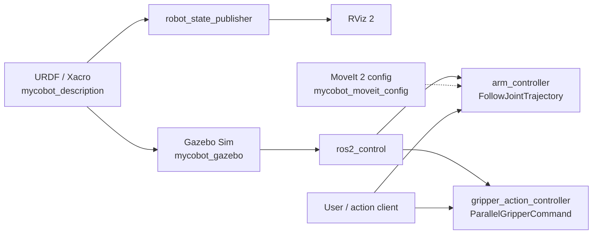

<div align="center">

# MyCobot 280: ROS 2 Simulation & Control

**URDF/Xacro model, Gazebo simulation, ros2_control and MoveIt 2 configuration for the Elephant Robotics MyCobot 280 arm, built on ROS 2 Jazzy.**


<!-- DEMO VIDEO: drag an .mp4 (under 10 MB) into this README on GitHub, or use a GIF -->
<!--  -->
> 🎥 **DEMO VIDEO PLACEHOLDER**: replace this line with `docs/media/demo.gif`, or a YouTube thumbnail linking to the full video.

</div>

---

## Table of Contents
1. [Overview](#overview)
2. [Demo](#demo)
3. [Features](#features)
4. [System Architecture](#system-architecture)
5. [Repository Structure](#repository-structure)
6. [Getting Started](#getting-started)
7. [Usage](#usage)
8. [Controller Interfaces](#controller-interfaces)
9. [Results](#results)
10. [Development Status](#development-status)
11. [Troubleshooting](#troubleshooting)
12. [Roadmap](#roadmap)
13. [Acknowledgements & Licensing](#acknowledgements--licensing)
14. [Author](#author)

---

## Overview

This project brings the **MyCobot 280** 6-joint arm into the ROS 2 ecosystem. It covers the full software path from robot description to command interface:

- the robot's **URDF/Xacro** description,
- **RViz 2** visualization through `robot_state_publisher`,
- **Gazebo** simulation with **ros2_control**,
- **FollowJointTrajectory** control for the arm and **ParallelGripperCommand** control for the gripper.

> **Scope:** simulation and software integration. Physical-robot validation is **not claimed** in this repository.

---

## Demo

| RViz 2 visualization | Gazebo simulation |
|:---:|:---:|
|  |  |
| *ADD SCREENSHOT: robot model in RViz 2* | *ADD SCREENSHOT: arm in Gazebo* |

| Arm trajectory | Gripper open/close |
|:---:|:---:|
|  |  |
| *ADD GIF: arm following a joint trajectory* | *ADD GIF: gripper action goal* |

📹 **Full walkthrough video:** `ADD YOUTUBE / DRIVE LINK`

> Tip: record with `peek` or `ffmpeg`, keep GIFs under about 8 MB, and store them in `docs/media/`.

---

## Features

- ✅ Robot description in **URDF/Xacro**
- ✅ **RViz 2** visualization using `robot_state_publisher`
- ✅ **Gazebo** simulation integration with **ros2_control** configuration
- ✅ Arm control through the `FollowJointTrajectory` action interface
- ✅ Gripper command tested through `ParallelGripperCommand`
- ✅ Separate packages for description, simulation, bringup, MoveIt 2 config and system tests

---

## System Architecture



<!-- Replace or supplement with your own exported diagram: docs/media/architecture.png -->

---

## Repository Structure

| Package | Purpose (**VERIFY each row**) |
|---|---|
| `mycobot_description` | URDF/Xacro model, meshes, `robot_state_publisher` launch |
| `mycobot_gazebo` | Gazebo simulation worlds and launch files |
| `mycobot_bringup` | Top-level launch files that start the system |
| `mycobot_moveit_config` | MoveIt 2 configuration for the arm |
| `mycobot_ros2` | Core package(s) for the MyCobot integration |
| `mycobot_system_tests` | System-level tests |

> Run `colcon list` inside your workspace to see what your checkout contains.

---

## Getting Started

### Requirements
- Ubuntu 24.04 with **ROS 2 Jazzy**
- `colcon` and `rosdep`
- RViz 2 and the Gazebo version used by the launch files

### Build

```bash
mkdir -p ~/ros2_ws/src && cd ~/ros2_ws/src
git clone https://github.com/Yashs2024/mycobot-280-ros2.git mycobot_ros2

cd ~/ros2_ws
source /opt/ros/jazzy/setup.bash
rosdep install --from-paths src --ignore-src -r -y
colcon build --symlink-install
source install/setup.bash
```

If `rosdep` cannot resolve a dependency, install it manually or check its upstream project.

---

## Usage

### 1. Visualize the robot description

```bash
source ~/ros2_ws/install/setup.bash
ros2 launch mycobot_description robot_state_publisher.launch.py
```

### 2. Launch the simulation
```bash
# ADD the exact command you use, for example:
# ros2 launch mycobot_bringup <your_launch_file>.launch.py
```

### 3. Send an arm trajectory
```bash
# ADD one tested FollowJointTrajectory goal here, with joint values you verified
```

### 4. Command the gripper

```bash
ros2 action send_goal /gripper_action_controller/gripper_cmd \
  control_msgs/action/ParallelGripperCommand \
  "{command: {name: ['gripper_controller'], position: [-0.7], effort: [5.0]}}"
```

Run this only while the gripper controller is active. Start with conservative values and check the joint limits first.

---

## Controller Interfaces

| Interface | Endpoint | Action type |
|---|---|---|
| Arm | `/arm_controller/follow_joint_trajectory` | `control_msgs/action/FollowJointTrajectory` |
| Gripper | `/gripper_action_controller/gripper_cmd` | `control_msgs/action/ParallelGripperCommand` |

**Arm joints:** `link1_to_link2`, `link2_to_link3`, `link3_to_link4`, `link4_to_link5`, `link5_to_link6`, `link6_to_link6_flange`

> **Gripper note:** this setup uses `parallel_gripper_action_controller/GripperActionController`. Many older tutorials use `control_msgs/action/GripperCommand`, which is a different interface. Use the one your running controller reports.

Useful checks:

```bash
ros2 action list -t
ros2 control list_controllers
ros2 topic list
```

---

## Results

> Replace the placeholders only with numbers you measured.

| Metric | Value |
|---|---|
| Gripper goal accepted and executed in simulation | `ADD yes/no, number of trials` |
| Arm trajectory tracking error | `ADD (rad), or remove this row` |
| Trajectory execution time (example motion) | `ADD (s)` |
| Controller update rate | `ADD (Hz)` |

---

## Development Status

| Area | Status |
|---|---|
| URDF/Xacro description | ✅ Present |
| RViz 2 / robot_state_publisher workflow | ✅ Launched during development |
| ros2_control + arm trajectory interface | 🟡 Configured; end-to-end validation in progress |
| Parallel gripper action | ✅ Command interface tested |
| MoveIt 2 planning | `ADD STATUS` |
| Physical robot validation | ❌ Not claimed |

---

## Troubleshooting

| Problem | Fix |
|---|---|
| Action or controller is missing | Confirm the right launch file is running and the overlay is sourced in the same terminal |
| `rosdep` cannot resolve a package | Install it manually, or check the upstream project |
| Gripper goal rejected | Check the interface type with `ros2 action list -t` and the joint limits |
| Robot not visible in RViz | Set *Fixed Frame* to the base link and confirm `robot_state_publisher` is running |

---

## Roadmap

- [ ] Reproducible simulation launch from a clean workspace
- [ ] Verified arm trajectory examples with joint-limit notes
- [ ] MoveIt 2 pick-and-place demo in simulation
- [ ] Demo video and architecture diagram
- [ ] Documented simulation-versus-hardware differences
- [ ] Continuous integration (`colcon build` and `colcon test` on GitHub Actions)

---

## Acknowledgements & Licensing

This repository may include meshes, models or assets from upstream projects, such as Elephant Robotics' MyCobot resources. Keep their license and attribution notices, and credit them here before redistributing.

- Upstream source(s): `ADD LINKS`
- License of this repository: `ADD LICENSE (MIT / Apache-2.0)`

---

## Author

**Yash Surve**: Automation & Robotics Engineering, SPPU
[GitHub](https://github.com/Yashs2024) · [LinkedIn](https://linkedin.com/in/yash-surve-3b6a72253) · [Portfolio](https://yashsurve.vercel.app)

Related project: [Yahboom Rosmaster X3 (ROS 2)](https://github.com/Yashs2024/yahboom-rosmaster-ros2)
